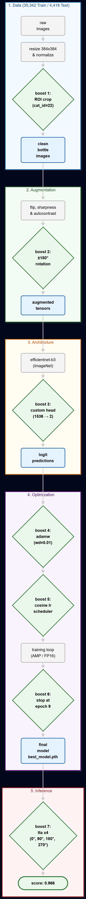

# 1st Krones Vision AI Challenge — Bottle Reusability Classification (Computer Vision project)

End-to-end Deep Learning pipeline developed for the **1st Krones Vision AI Challenge** (June 2026), automating high-speed inspection of returnable bottles on production lines (Reusable vs. Not Reusable).

 **[For more details and insights, view the full Project presentation and roadmap here -> (PDF)](./docs/kronesVision.pdf)** \\
 **[For more information regarding the project, rules, format, teams and submissions, please check it out here -> (Kaggle website)](https://www.kaggle.com/competitions/1st-krones-vision-ai-challenge)

---

## System Architecture | Pipeline
<p align="center">
  
</p>

Our solution leverages transfer learning on **EfficientNet-B3** (`384×384` input resolution) with 7 strategic optimizations:
1. **ROI Cropping (`category_id == 22`):** Parses COCO JSON annotations to crop strictly to the bottle bounding box, eliminating factory background noise.
2. **Production-Line Augmentations:** `RandomRotation(±180°)`, `RandomHorizontalFlip(p=0.5)`, `RandomAdjustSharpness`, and `RandomAutocontrast` to achieve full rotation invariance.
3. **Custom Classification Head:** Replaced the default classifier with a `Linear(1536 -> 2)` binary output layer.
4. **Decoupled Regularization:** Trained using `AdamW` (`lr=0.0005`, `weight_decay=0.01`) and `CrossEntropyLoss`.
5. **Smooth Convergence:** `CosineAnnealingLR` scheduler paired with Automatic Mixed Precision (`torch.amp`) for GPU efficiency.
6. **Early Stopping at Epoch 9:** Checkpointed best weights at **Epoch 9** (`Valid Loss: 0.1013`, `Val Acc: 96.02%`, `Val F1-Macro: 95.89%`), achieving a >50% reduction from initial training loss (`0.2021 -> 0.1013`) while preventing late-epoch overfitting.
7. **Test Time Augmentation (TTA x4):** Deterministic inference averaging probability distributions across 4 rotational passes (`0°`, `90°`, `180°`, `270°`).

---

## Model Evolution & Benchmarks
| Architecture | Hidden Test Score | Key Findings |
| :--- | :---: | :--- |
| **Fast-RCNN** | `~0.940` | Bounding-box detection overhead was unnecessary since COCO JSON ROIs were already provided. |
| **ResNet-18** | Baseline | Fast initial benchmark, but lacked parameter efficiency for subtle surface defects. |
| **ConvNeXt** | `~0.957` | High capacity, but data-hungry on 35,342 images; converged slower and was prone to overfitting. |
| **EfficientNet-B3 (Ours)** | **`0.966`** | Optimal balance via compound scaling, enhanced with `AdamW`, Epoch 9 checkpointing, and `TTA x4`. |

---

## Repository Structure
* `38-training-notebook.ipynb` — Stratified 80/20 split, ROI cropping, augmentation pipeline, and AMP training loop.
* `38-evaluation-notebook.ipynb` — TTA x4 rotational ensemble inference on the 4,418 test images.
* `test_predictions.csv` — Final generated predictions (`image_id`, `target`).
* `docs/` — Project presentation deck and architecture diagrams.
* `requirements.txt` — Python dependencies.

---

## [CRUCIAL] Configuration AND Local Setup info
The notebooks were executed inside the Kaggle cloud environment (where the challenge took place) and retain their original execution logs. If you wish to run the pipeline locally on a custom dataset, update the path variables in **Cell 5** of both notebooks:

**In Training Notebook:**
```python
TRAIN_CSV = './data/train.csv'
TRAIN_DIR = './data/train_images'
TRAIN_JSON = './data/train_annotations.json'
```

**Authors:** Andrei Valentin Bălălău, Theodor Constantinescu, Rose Mary Joseph
